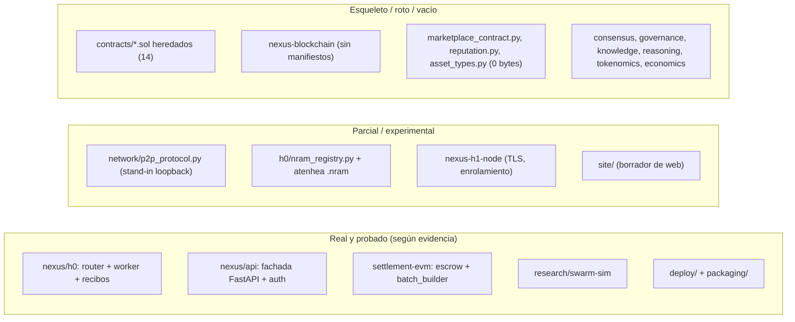

# 01 · Análisis del repositorio (auditoría honesta)

Fecha: 2026-10-27 · Autor: product-architect · Repo: `/Users/david/Desktop/NEXUS` (rama `main`, HEAD `4fd8098`)

Método: lectura de `README.md`, `EXECUTIVE_BRIEF.md`, `FUSION.md`, `PROJECT_DELIVERY.md`, `docs/` (spec y los 5 JSON de evidencia), código de `NEXUS/nexus/h0`, `NEXUS/settlement-evm`, `NEXUS/atenhea`, `NEXUS/nexus/network/p2p_protocol.py`, `NEXUS/site`, `NEXUS/deploy`, `NEXUS/packaging` y `research/swarm-sim`.

**Qué he ejecutado yo** (el resto es lo que afirman los documentos del repo, sin reverificar):

| Comando | Resultado real |
|---|---|
| `cd research/swarm-sim && python3 -m unittest` | 26 tests, OK |
| `python3 swarmsim.py --nodes 5000` | 12 s; reproduce las cifras del README del simulador (exposición, throughput, coalición, Sybil, recuperación) |
| `cd NEXUS/settlement-evm && python3 -m unittest discover -s tests_python -p test_batch_builder.py` | 13 tests, OK (stdlib puro) |
| H0 (`test_h0.py`), Foundry, Compose, Anvil | **No ejecutados**: este entorno es Python 3.9.6 sin `cryptography`, sin `forge`/`anvil`. Me apoyo en `docs/evidence/*.json`. |

---

## 1. Veredicto en una página

1. **Lo que existe y está razonablemente probado** es una vertical de inferencia de **réplica completa**: cada nodo ejecuta el modelo entero (Gemma E2B vía Atenhea) y la red hace *routing + recibos firmados + liquidación por lotes*. Esto es útil como **plano de control, metering y liquidación**.
2. **Lo que el producto NEXUS promete (ningún operador tiene el modelo completo, cómputo repartido por etapas) no existe en el código.** Solo existe como simulación en `research/swarm-sim`. Atenhea (`NEXUS/atenhea/native_runtime.py`) carga el checkpoint HF completo en un proceso; no hay ejecución por rangos de capas, ni transporte de activaciones, ni troceado/cifrado/erasure de pesos.
3. **El repo sobreafirma** en varios puntos (ver §5). La mayor parte del árbol (`NEXUS/nexus/{consensus,governance,tokenomics,economics,knowledge,reasoning,...}`, 14 contratos Solidity heredados, Substrate) es **inventario de diseño sin integrar**; los propios documentos del repo lo admiten en letra pequeña.
4. **Pivot necesario**: H0 asume "cada operador tiene los pesos base" (`README.md` §intro, `FUSION.md` principio 1). El brief del producto exige lo contrario. El pivot reaprovecha ~15 % del código (protocolo, recibos, escrow) y obliga a escribir lo diferencial (almacenamiento, runtime por etapas, coordinador de slots).

## 2. Mapa del repositorio por madurez

## 3. Inventario detallado

### 3.1 Real y probado

| Pieza | Ruta | Qué hace de verdad | Evidencia | Límite |
|---|---|---|---|---|
| Router/gateway H0 | `NEXUS/nexus/h0/router.py` (1119 líneas) | Cola SQLite, registro y heartbeat de nodos, `POST /v1/chat/completions` (no streaming), leases con reintento (máx. 3), purga de contenido a 30 días, modo `remote` TLS + bearer, `/metrics` | `docs/evidence/h0-mock-2026-10-26.json` (100/100 jobs, mock) | Un solo proceso Python/SQLite; sin streaming; sin tools; HTTP `ThreadingHTTPServer` con hilos acotados |
| Worker | `NEXUS/nexus/h0/worker_agent.py` | Polling firmado, ejecuta contra motor Atenhea, mide tokens con el tokenizer del motor, firma recibo | `h0-real-2026-10-25.json` (100/100 con **Atenhea real**, salida ≤24 tokens, 13,29 tok/s) | **Un job a la vez** por nodo; solo macOS/MPS validado; "no es benchmark" (lo dice la evidencia) |
| Recibos y firmas | `NEXUS/nexus/h0/nexus_common.py` | JSON canónico + Ed25519 (`cryptography`), JWT EdDSA de despacho (≤30 min), firmas de petición con nonce y ventana ±60 s, `split_payment` 75/10/5/5/5 | `test_h0.py`, `test_secure_remote.py` | Recibo atestigua **medición declarada y hash de salida**, no que se ejecutó el modelo correcto |
| Fachada API | `NEXUS/nexus/api/` | API keys con hash+scopes, cuentas scrypt, sesiones en Valkey, cuotas, `/v1/models`, `/v1/chat/completions`, `/jobs/{id}` con aislamiento por cliente | `auth-multiuser-compose-2026-10-26.json` (37/37 + E2E Compose) | Mock; Compose local en Colima; sin CI remoto |
| Escrow por lotes | `NEXUS/settlement-evm/src/InferenceEscrow.sol` (347 líneas) | Depósito agregado ERC-20, raíz Merkle-sum publicada por *signer*, `claimMany`, reparto 75/10/5/5/5 en unidades del token, ventana de disputa de 7 días y resolución por *owner* | `settlement-anvil-2026-10-26.json` (Foundry 21/21 al escribirse; hoy el test file tiene 30 `function test*`, **no reejecutados por mí**) | Signer de gateway **de confianza**; el contrato no verifica Ed25519; sin stake/bond de nodo; "burn" = transferencia a `0x…dEaD`; owner inmutable; sin auditoría; nunca desplegado en testnet |
| Constructor de lotes | `NEXUS/settlement-evm/batch_builder.py`, `receipt_to_batch.py` | Keccak-256 en Python puro, hojas V2 con dominio/chainId/escrow/token, puente SQLite→lote con *pinning* de fingerprints de clave de nodo y regalías a autores | 13 tests re-ejecutados por mí: OK (31/31 según docs) | Fuente de verdad privilegiada = SQLite del router |
| Simulador | `research/swarm-sim/swarmsim.py` (760 líneas) | 9 escenarios: etapas, slots, coalición, Sybil, fallos correlados, recuperación | Re-ejecutado por mí | **Modelo analítico**; "no mide hardware real" (su propio README) |
| Despliegue | `NEXUS/deploy/` (`deploy.sh`, `compose.prod.yml`, Caddy) | Edge TLS → UI → API → Router TLS interno → worker; secretos por fichero, `read_only`, `cap_drop ALL`, rollback | Doc README; **no verificado por mí** | Sin dominio ni host real; engine Atenhea externo |
| Empaquetado | `NEXUS/packaging/build_node_bundle.sh` | Tarball reproducible solo de ficheros versionados, escaneo de secretos, `SHA256SUMS` | `NEXUS/site/descargas/manifest.json` tiene `artifacts: []` | No hay artefactos publicados |

### 3.2 Parcial o experimental

| Pieza | Ruta | Estado real |
|---|---|---|
| P2P | `NEXUS/nexus/network/p2p_protocol.py` | Commit `99afdea`/`71eab46`: ahora **sí** implementa los 5 métodos que `FUSION`/spec dicen ausentes, con Ed25519 real, **pero** sobre `LocalTcpTransport` (TCP solo loopback, "NO es libp2p"), sin anti-replay ni lista de confianza; tras `NEXUS_EXPERIMENTAL_P2P=1`. No usar. |
| Registro `.nram` | `NEXUS/nexus/h0/nram_registry.py` + `router.py` `POST /nram` | Valida contenedor NRA-M v2 (magic, longitudes, `tensor_sha256`, máx. 64 MiB); id = SHA-256 del fichero; autor ligado al token del cliente. Es un registro **de adaptadores LoRA**, no de modelos troceados. |
| Atenhea | `NEXUS/atenhea/` (≈1.4 k líneas `onram.py`, 410 `native_runtime.py`) | Motor Gemma E2B local: funciona en Mac/MPS, "un hilo de inferencia", sin CUDA ni Windows (`atenhea/README.md`). Reutilizable como **ejecutor de modelo completo**, no como ejecutor de etapas. |
| Nodo H1 | `NEXUS/nexus-h1-node/` | Worker con TLS/CA fijada, enrolamiento por token/clave, rotación de cert; probado host→VM local (Colima), **no** entre redes (docs). |
| Web borrador | `NEXUS/site/` | HTML estático ES. Ver §5 (afirmaciones a corregir). |

### 3.3 Esqueleto, roto o vacío (inventario de diseño)

| Pieza | Ruta | Por qué no cuenta |
|---|---|---|
| Contratos heredados | `NEXUS/contracts/*.sol` (14) | Nombres duplicados (`NexusToken` ×2, `NexusStaking` ×2, `NexusGovernance` ×2), `else:` de Python en `Staking.sol`, funciones sin definir, OpenZeppelin no vendorizado (`PROJECT_DELIVERY.md` M4). `NEXUS/test/ContractSecurity.t.sol` importa rutas inexistentes. |
| Substrate | `NEXUS/nexus-blockchain/` | Sin `Cargo.toml`; runtime referencia tipos no definidos. |
| Marketplace/reputación | `NEXUS/{marketplace_contract,reputation,asset_types}.py` | **0 bytes** (verificado con `wc -c`). |
| Cognitivo heredado | `NEXUS/nexus/{reasoning,knowledge,llm,consensus,governance,sync,...}` | LLM = cliente LangChain a APIs externas; memoria vectorial/grafo con llamadas a métodos inexistentes (`EXECUTIVE_BRIEF.md` "Backend general"). |
| Tokenomics | `NEXUS/nexus/{tokenomics,economics}/` | Tarifas fijas y emisión inflacionaria que la propia spec §8 deroga. Además contradice la regla "sin token en v0.1". |
| Infra heredada | `NEXUS/{kubernetes,charts,infra,docker-compose.yml,monitoring,risk_management}` | Terraform/CI con referencias a recursos inexistentes; Helm solo lint/render, sin clúster. |

## 4. Brecha entre el repo y el producto v0.1

| Capacidad del brief v0.1 | ¿Existe? | Dónde / qué falta |
|---|---|---|
| Gateway OpenAI-compatible | **Sí** (sin streaming) | `NEXUS/nexus/h0/router.py` `_handle_chat_completion`, `NEXUS/nexus/api/` |
| Agente de nodo | **Parcial** | `worker_agent.py` es de réplica completa; falta modo "stage worker" |
| CLI de publicación (partir → cifrar → EC → manifiesto firmado) | **No** | Todo nuevo: `nexus_storage`, `nexus_cli` |
| Coordinador con slots y enrutado proporcional | **No** (solo en simulador: `swarmsim.py::assign_slots`, `SlotPlan`) | Nuevo en `nexus_runtime` |
| Recibos firmados + libro + lotes | **Sí** para réplica completa | Extender recibo a multi-etapa (`work_share`) |
| Demo multiproceso con modelo pequeño real por etapas | **No** | Nuevo; Atenhea no sirve (carga el modelo completo) |
| Escrow por lotes | **Sí** (local) | Falta decidir qué se liquida sin token (ver ADR-03) |

## 5. Contradicciones y sobreafirmaciones detectadas

| # | Documento | Afirmación | Realidad / contradicción |
|---|---|---|---|
| C1 | `README.md` l.3, `FUSION.md` principio 1, `NEXUS/site/index.html` ("Tus pesos y tu memoria se quedan en tu máquina") | Cada operador conserva sus pesos base; privacidad "por diseño". | Es el modelo de **réplica completa**: choca con el brief ("ningún operador tiene el modelo completo"). Además el operador **ve en claro los prompts** y las respuestas del cliente; la web lo presenta como "privado". Debe reescribirse. |
| C2 | `EXECUTIVE_BRIEF.md` tabla de madurez | "H1 remoto es seguro y operable entre redes — Alta" | La misma fila admite que solo se probó host→VM local. La confianza "Alta" no cabe. |
| C3 | `EXECUTIVE_BRIEF.md` | Settlement local "Alta" | El signer de gateway es de confianza y puede autorizar pagos arbitrarios hasta el depósito (el propio README del escrow lo dice). Es una integración **simulada** con token mock. |
| C4 | `settlement-evm/README.md` ("Dispute resolution, node staking … are not implemented") y `PROJECT_DELIVERY.md` ("Definir disputas") | Disputas sin implementar | `InferenceEscrow.sol` ya tiene `openDispute`/`resolveDispute` y `DISPUTE_WINDOW = 7 days` (commits `b5659d3`, `7abbc78`). El README y la hoja de entrega están **desactualizados**; y el árbitro es el `owner` (centralizado). |
| C5 | `docs/evidence/settlement-anvil-*.json`, `PROJECT_DELIVERY.md` | "Foundry 21/21" | `test/InferenceEscrow.t.sol` tiene hoy 30 funciones `test*`; la cifra es previa a las disputas. No reejecutado por mí. |
| C6 | `FUSION.md`/spec §1.2, `PROJECT_DELIVERY.md` | P2P "roto: 5 métodos inexistentes" | Ya existen (commit `99afdea`), como stand-in loopback experimental. Docs desfasados. |
| C7 | `README.md` "Requisitos: Python 3.10+", Atenhea "Python 3.12" | — | Este entorno es 3.9.6; el nuevo código debe correr en 3.9 (brief §4). Toda la cripto de H0 depende de `cryptography`, que aquí no está. |
| C8 | Spec §8.1 y `InferenceEscrow.sol` | "Quema 5 %" | Es una transferencia a `0x…dEaD` de un ERC-20 cualquiera, no reducción de oferta (lo reconoce el README del escrow). Sin token propio en v0.1, el reparto 5/5 a *burn*/tesoro necesita rediseño (ADR-03). |
| C9 | Spec §0/§8.4 | "El negocio no es vender tokens baratos" (E2B ≈ 0,17 $/día por nodo) | El brief del producto promete "precio por debajo de proveedores centralizados" en modelos mayores. Ninguna cifra de coste/precio de modelos grandes está medida: `[POR VERIFICAR]`. El simulador da 1,6–7 tok/s por stream con S=8–16: **no compite en latencia** y el precio no está demostrado. |
| C10 | Brief §2 (una frase) vs `swarm-sim/README.md` | "S=8 ≈ exposición de coalición 30 % ≈ 0,03" junto a "con ~300 nodos por slot una coalición del 2 % reúne el modelo con P≈0,44" | Son **dos diseños distintos** del simulador. 0,03 es el escenario 1 (3 réplicas por etapa, `random`); 0,44/0,99 es el escenario 6 (todos los nodos de cada slot, S=16, T=1). El diseño elegido (slots, escenario 5–6) tiene la **peor** exposición ante coaliciones. No se pueden citar las dos cifras como si describieran el mismo sistema. (Ver `04-modelo-de-amenazas.md`.) |
| C11 | `EXECUTIVE_BRIEF.md` fecha 26-oct, rama `codex/nexus-e2e-functional` | "Estado actual" | HEAD (27-oct, `main`) trae más: registro `.nram`, memoria CHL por cuenta, enrolamiento por clave, P2P experimental, disputas. Los resúmenes ejecutivos no están sincronizados con el código. |
| C12 | Credencial expuesta | `README.md`, `EXECUTIVE_BRIEF.md` | Existe una clave OpenRouter antigua en el historial (`8445b54`). El árbol actual ya no la contiene, pero **no hay evidencia de rotación**. Acción humana pendiente; no se reproduce aquí. |
| C13 | `NEXUS/site/estado.html` / `index.html` | Estado "Listo: ejecución local (H0)" | Cierto, pero no menciona que H0 es réplica completa ni que el operador ve los prompts. Ver `04-modelo-de-amenazas.md` §7 para el texto permitido. |
| C14 | `docs/spec-fusion-nexus-atenea.md` §7.1 ("el Gateway observa el stream: el nodo no puede inflar tokens sin que se vea") | Medición independiente por el gateway | En `NEXUS/nexus/h0/router.py` l.959 la discrepancia se calcula contra `engine_prompt_tokens/engine_completion_tokens` **que el propio worker declara en el recibo**. Es consistencia interna, no medición independiente. Un worker deshonesto puede falsear ambos campos. |

## 6. Decisión: reutilizar / reescribir / descartar

| Componente | Ruta | Decisión | Motivo | Destino en `nexus-project/code/` |
|---|---|---|---|---|
| Formato de recibo canónico + Ed25519 + JWT de despacho | `h0/nexus_common.py` | **Reutilizar (copiar y extender)** | Probado, formato estable, firmas de petición con nonce | `nexus_runtime/receipts.py` (añadir campos `stage`, `work_units`, `activation_hash`) |
| Router: cola, leases, reintentos, purga, auth remota | `h0/router.py` | **Reescribir parcialmente** | 1 119 líneas monolíticas, un solo proceso; la lógica (leases, ownership, 503/Retry-After) vale, pero el reparto es por **slot/etapa**, no por job completo | `nexus_runtime/coordinator.py`; portar tests (`test_disconnect_requeue.py`, `test_job_ownership.py`) |
| Worker | `h0/worker_agent.py`, `nexus-h1-node/worker2.py` | **Reescribir** | Modelo de ejecución distinto (etapa con estado KV, entrada/salida = activaciones). Reutilizar el handshake firmado y enrolamiento | `nexus_runtime/node_agent.py` |
| Fachada API | `nexus/api/` | **Reutilizar la capa de auth/cuotas; reescribir el backend** | Dependencia FastAPI/Valkey no disponible en 3.9 stdlib; contrato `/v1/chat/completions` se conserva | `nexus_api/` (stdlib `http.server` ahora, interfaz sustituible) |
| Escrow y `batch_builder` | `settlement-evm/` | **Reutilizar** (leer, no modificar; v0.2) | Es lo más sólido del repo. Para v0.1 se usa solo el **libro** + lote Merkle off-chain | `nexus_runtime/ledger.py` importa `batch_builder.py` por ruta |
| Registro `.nram` | `h0/nram_registry.py` | **Reutilizar la idea** (id = hash, autor ligado a token) | El contenedor es de adaptadores LoRA; el manifiesto nuevo es otro | `nexus_storage/manifest.py` |
| Atenhea (motor) | `NEXUS/atenhea/` | **No reutilizar en v0.1**; mantener como backend opcional de "réplica completa" | No parte modelos; Mac-only; ~1 gen. a la vez | — (ver ADR-05) |
| Simulador | `research/swarm-sim/` | **Reutilizar como oráculo de decisiones** | Fija S, EC y asignación; ampliar con medidas del prototipo | `docs/product/` (referencias) |
| Despliegue y empaquetado | `deploy/`, `packaging/` | **Reutilizar la plantilla** | Buenas prácticas ya aplicadas (secretos por fichero, rollback, SHA256SUMS) | `code/deploy/` (eng-runtime) |
| Web borrador | `NEXUS/site/` | **Reescribir mensajes** | C1, C13; la estructura sirve | `nexus-project/site/` (landing) |
| P2P experimental | `network/p2p_protocol.py` | **Aparcar** | No libp2p, sin anti-replay; v1.0 | — |
| Contratos heredados, Substrate, tokenomics, economics, cognitivo, k8s/terraform | ver §3.3 | **Descartar** del producto | No compilan / no integrados / contradicen "sin token v0.1" | — (no borrar del repo; no tocarlo) |

## 7. Qué se puede decir hoy con verdad (resumen)

- "Existe un prototipo local de enrutado de inferencia con recibos firmados que completó 100/100 trabajos de prueba contra un motor real (salida limitada a 24 tokens)". (`docs/evidence/h0-real-2026-10-25.json`)
- "Existe un simulador que cuantifica el compromiso secreto/latencia." (`research/swarm-sim`)
- **No** se puede decir que existe una red, que se reparta un modelo entre nodos, que haya nodos externos ni pagos. Lista completa en `04-modelo-de-amenazas.md` §7.
