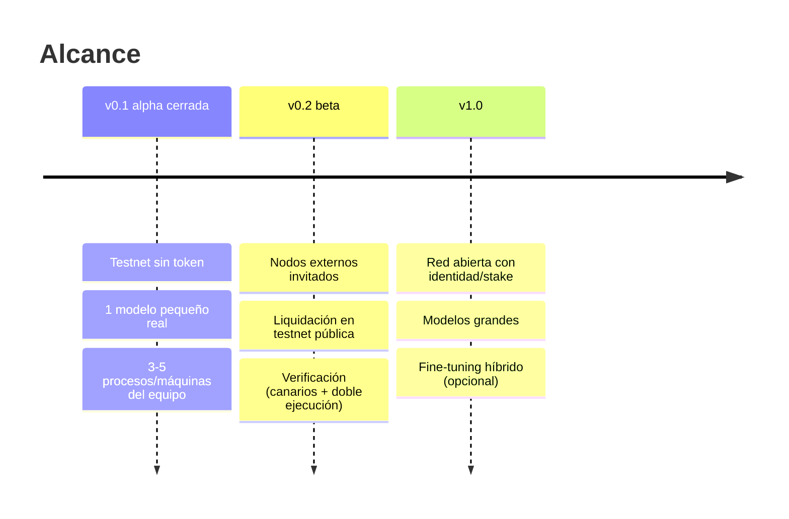

# 02 · PRD — NEXUS (Product Requirements Document)

Versión 0.1 · 2026-10-27 · Estado: propuesta para decisión del fundador. Las cifras marcadas **[SUPUESTO]** son hipótesis de trabajo sin evidencia; las marcadas **[SIM]** salen de `research/swarm-sim`; **[POR VERIFICAR]** falta dato.

## 1. Visión

> Una red donde **ningún operador posee el modelo completo** y el cómputo se reparte entre nodos independientes **en proporción a lo que cada uno aporta**, con recibos firmados verificables.

Lo que NEXUS **no** es: no es privacidad total, no es "imposible de copiar", no es "trustless". Es una **red de cómputo con pesos particionados**: reduce lo que cada operador ve (1/S del modelo), no lo elimina; una coalición lo bastante grande puede reconstruirlo; quien consulta puede destilarlo (`04-modelo-de-amenazas.md`).

### Por qué existiría (hipótesis de valor, a validar)

| Hipótesis | Estado |
|---|---|
| H-A. Hay desarrolladores que aceptan menor velocidad por una API OpenAI-compatible sobre modelos abiertos con **recibos verificables** | **[POR VERIFICAR]** (entrevistas, ver `05-roadmap.md` E-Demanda) |
| H-B. Hay autores de modelos/adaptadores que querrían publicar sin entregar los pesos en claro a un único operador | **[POR VERIFICAR]**; limitación: la protección es parcial |
| H-C. Hay dueños de GPU dispuestos a servir un 1/S de un modelo por pago por trabajo verificado | **[POR VERIFICAR]**; la spec original estima céntimos/día por nodo con E2B a precios commodity (`docs/spec-fusion-nexus-atenea.md` §8.4) |
| H-D. Precio por debajo de proveedores centralizados | **[POR VERIFICAR]**: sin medición de coste real ni de precio de mercado de modelos grandes. No usar en marketing hasta medirlo. |

## 2. Usuarios (3 lados del mercado)

### 2.1 Desarrollador consumidor de API

| | |
|---|---|
| Quién | Dev/startup que ya usa el SDK de OpenAI; modelos abiertos; carga batch o asíncrona antes que chat interactivo |
| Trabajo a resolver | "Quiero inferencia sobre un modelo abierto sin depender de un único proveedor y con prueba de cuánto consumí" |
| Qué recibe | Endpoint `/v1/chat/completions` y `/v1/models`, API key, recibo firmado por trabajo, aviso explícito de latencia |
| Qué NO recibe | Confidencialidad frente a la red (el gateway ve el prompt; el primer slot ve embeddings; el último ve logits), SLA, streaming rápido |
| Fricción esperada | Latencia: **[SIM]** S=8 ≈ 4–6 tok/s por stream, S=16 ≈ 2,8 tok/s (70B int4) |

### 2.2 Operador de nodo

| | |
|---|---|
| Quién | Aficionado con GPU, pequeño centro de datos, universidad |
| Trabajo | "Cobrar por la capacidad que aporto, sin tener que confiar la custodia de un modelo propietario completo" |
| Qué hace | Instala el agente, se registra, recibe **un slot fijo**, sirve ese rango de capas |
| Qué recibe | Pago **proporcional al trabajo verificado** (`work_share`). Sin promesas de ingresos |
| Riesgos que debe conocer | Su slot queda **en claro en su memoria**; stake/identidad (futuro); posible slash; el trabajo verificado puede rechazarse |

### 2.3 Autor de modelo

| | |
|---|---|
| Quién | Quien afina o entrena un modelo/adaptador y quiere cobrar regalías |
| Trabajo | Publicar → cobrar `royalty_bps` por uso, sin entregar los pesos completos a un único operador |
| Qué recibe | CLI `nexus publish`, manifiesto firmado con su clave, regalía en el libro (royalty en el reparto: ya soportado en `settlement-evm` y `receipt_to_batch.py` para `.nram`) |
| Límite | Un coalición puede reconstruir; el consumidor puede destilar; licencia del modelo base obligatoria (Gemma, Llama…) |

## 3. Problemas que se resuelven

| # | Problema | Mecanismo |
|---|---|---|
| P1 | Dependencia de un proveedor centralizado con visibilidad total del modelo y los prompts | Partición en S slots; ningún operador > 1/S **[SIM: `max_fraccion_por_operador = 1/S`]** |
| P2 | Imposibilidad de auditar consumo | Recibos Ed25519 por etapa + libro de contribuciones |
| P3 | Pago injusto por capacidad desigual | Enrutado proporcional a velocidad y `work_share` **[SIM: eficiencia 0,956 con asignación estratificada]** |
| P4 | Pérdida de pesos al salir un nodo | Erasure coding k-de-n (10-de-16, 1,6×); unir un nodo a un slot de 2,2 GB ≈ 60 s p50 **[SIM]** |

## 4. Propuesta de valor (formulable hoy sin mentir)

- Para el dev: "API compatible con OpenAI sobre modelos abiertos, con recibo firmado por trabajo. Alpha cerrada, testnet, sin dinero real."
- Para el operador: "Pago por trabajo verificado (en testnet). Ningún operador tiene el modelo completo."
- Para el autor: "Publica con manifiesto firmado y regalías en el libro. La protección de pesos es parcial."

## 5. Alcance por versión

### 5.1 v0.1 — alpha cerrada (testnet, sin token, sin dinero real)

| ID | Entregable | Aceptación |
|---|---|---|
| A1 | `nexus publish`: partir en S slots → cifrar → EC k-de-n → manifiesto firmado | Round-trip: `fetch_slot` reconstruye capas bit a bit con n−k fragmentos perdidos; manifiesto verifica firma y Merkle |
| A2 | Coordinador con asignación estratificada y enrutado proporcional | Con N nodos simulados, ningún operador en >1 slot; reparto de trabajo ∝ velocidad (±10 % **[SUPUESTO]**) |
| A3 | Agente de nodo: obtiene clave del slot, descarga trozos, verifica Merkle, sirve etapa | Un nodo se une a su slot y sirve su primera petición |
| A4 | Gateway OpenAI-compatible (`/v1/chat/completions` no streaming, `/v1/models`) con API keys | El SDK oficial de OpenAI con `base_url` cambiada funciona |
| A5 | Inferencia por etapas de un modelo pequeño real repartido en ≥3 slots | Salida **idéntica** (o dentro de tolerancia numérica documentada) a la inferencia monolítica |
| A6 | Recibos por etapa + recibo de trabajo + libro + lote Merkle (off-chain) | Suma de `work_share` = 1; lote reproducible y verificable |
| A7 | Demo multiproceso reproducible con un comando | `README` + script; resultados reales reportados |

### 5.2 v0.2 — beta

Nodos externos invitados; verificación activa (canarios, doble ejecución muestreada); liquidación del lote en **testnet pública** con el escrow existente (tras revisión independiente, ver `05-roadmap.md`); streaming; reputación; registro de modelos firmado y versionado; observabilidad.

### 5.3 v1.0

Modelos de ≥ 7–70B con S=8–16; mitigaciones de coalición (corte T por capa en modo batch, huella por nodo, TEE opcional); identidad/Sybil con coste; decisión de token con revisión legal; fine-tuning híbrido (pipelines replicados) si E-Compresión sale positiva.

## 6. Requisitos funcionales

| ID | Requisito | v |
|---|---|---|
| RF-1 | Publicar un modelo: `layers → slots → cifrado → EC → manifiesto firmado` | 0.1 |
| RF-2 | Verificar un manifiesto (firma del autor, Merkle por slot, licencia presente) | 0.1 |
| RF-3 | Registro de nodo con clave Ed25519 y declaración de capacidad (VRAM, ancho de banda, región, operador) | 0.1 |
| RF-4 | Asignar operadores a slots: estratificada, baliza aleatoria publicada **tras** cerrar el registro; un operador = un slot | 0.1 |
| RF-5 | Liberar la clave del slot solo al nodo asignado (`KeyVault.grant`) | 0.1 |
| RF-6 | Enrutar cada etapa al nodo del slot con probabilidad ∝ velocidad medida; reintento en otro nodo del slot | 0.1 |
| RF-7 | Emitir recibo firmado por etapa y consolidarlo en recibo de trabajo con `work_share` por nodo | 0.1 |
| RF-8 | Libro de contribuciones persistente y lote Merkle-sum de liquidación | 0.1 |
| RF-9 | `/v1/chat/completions`, `/v1/models` OpenAI-compatibles; rechazar `tools` y streaming con error explícito | 0.1 |
| RF-10 | Aislamiento por cliente: un cliente no ve trabajos de otro (patrón de `h0/router.py`, `job_access_allowed`) | 0.1 |
| RF-11 | Reparación: detectar fragmentos perdidos y regenerarlos | 0.2 |
| RF-12 | Verificación: canarios (1–2 %) y doble ejecución muestreada (2 %) **[SUPUESTO heredado de la spec §7.2]** | 0.2 |
| RF-13 | Streaming SSE | 0.2 |
| RF-14 | Liquidación en testnet pública, con regalías a autores | 0.2 |
| RF-15 | Versionado y revocación de modelos | 0.2 |
| RF-16 | Reputación y expulsión por fallo de canarios | 0.2 |
| RF-17 | Identidad con coste (comisión no reembolsable, huella) | 1.0 |
| RF-18 | Corte por capa T y/o TEE opcional | 1.0 |

## 7. Requisitos no funcionales

| ID | Requisito | Umbral inicial |
|---|---|---|
| RNF-1 Honestidad | Toda la UI/docs lleva el estado (alpha, testnet, sin dinero real) y los límites de privacidad | Obligatorio; revisión contra la lista de `04-modelo-de-amenazas.md` §7 |
| RNF-2 Corrección | Salida por etapas ≡ monolítica en el modelo de prueba | Igualdad de tokens en `temperature=0` en 100 prompts **[SUPUESTO]** |
| RNF-3 Latencia | Informar, no prometer | **[SIM]** 1,6–7 tok/s por stream (S=8–16, 70B). Medir con el modelo pequeño real |
| RNF-4 Disponibilidad | Degradación gradual ante fallos | **[SIM]** S=16: salida del operador mayor → 0,96 de throughput; caída de región → 0,74 |
| RNF-5 Seguridad | Ed25519 + canónico JSON; claves por fichero 0600; sin secretos en el repo | Escaneo de secretos en CI |
| RNF-6 Cripto no auditada | Cualquier cripto en Python puro lleva `NOT AUDITED – replace with vetted library` y interfaces `Cipher`/`Signer` sustituibles | Brief §4 |
| RNF-7 Portabilidad | Python 3.9, stdlib por defecto; librerías auditadas opcionales | Tests con `python3 -m unittest` |
| RNF-8 Privacidad de datos | Retención de contenido de jobs acotada (patrón H0: 30 días + `secure_delete`) | 30 días por defecto **[SUPUESTO heredado de H0]** |
| RNF-9 Observabilidad | Métricas Prometheus básicas (patrón `h0/router.py` `/metrics`) | v0.2 |
| RNF-10 Licencias | Cada modelo del catálogo declara licencia en el manifiesto y se respeta | Bloqueo en `publish` si falta |

## 8. Métricas de éxito (umbrales iniciales = supuestos)

| Fase | Métrica | Umbral inicial [SUPUESTO] | Cómo se mide |
|---|---|---|---|
| v0.1 | Jobs de demo completados con recibos válidos | ≥ 99 % de 100 | Suite de demo |
| v0.1 | Equivalencia por etapas vs monolítico | 100 % de tokens iguales a T=0 (o desviación numérica documentada) | Test A5 |
| v0.1 | Desviación del reparto de trabajo respecto a la velocidad relativa | ≤ 10 % | Libro |
| v0.1 | Tiempo de unión de un nodo a un slot (red local) | < 5 min con slot de ~GB **[SIM: ~60 s p50 con 2,2 GB y red residencial]** | Demo |
| v0.2 | Nodos externos activos 7 días | ≥ 5 independientes (spec H3 pedía ≥5) | Libro |
| v0.2 | Trabajos completados sin reintento | ≥ 95 % (spec H3) | Libro |
| v0.2 | Falsos positivos de verificación a nodos honestos | < 5 % (kill criterion heredado, spec H1) | Canarios |
| v0.2 | Devs alpha con ≥ 100 peticiones | ≥ 10 **[SUPUESTO]** | API keys |
| v1.0 | Coste real por 1 000 tokens vs precio de referencia de mercado | `[POR VERIFICAR]` (requiere medir coste y recopilar precios con fuente y fecha) | Finanzas |

## 9. Fuera de alcance (explícito)

- Token, ICO, venta pública, staking con valor, "NEX" (v0.1 y v0.2). Solo como opción futura con riesgo regulatorio (ADR-03).
- Garantía de confidencialidad del prompt frente a la red; "privacidad total".
- Entrenamiento distribuido de modelos base. Fine-tuning solo como línea de investigación en v1.0.
- Chat en tiempo real competitivo con APIs centralizadas.
- Tools/function calling, multimodal, embeddings.
- Redistribuir checkpoints sin respetar su licencia.
- P2P libp2p, DHT pública, descubrimiento sin permiso (v1.0 como mínimo).
- Marketplace de adaptadores `.nram` completo (queda el registro actual como referencia).
- Memoria personal por usuario sincronizada entre nodos (spec §14).
- Cualquier promesa de rentabilidad a operadores.

## 10. Dependencias y supuestos globales

- Un modelo pequeño real con licencia compatible, con capas uniformes partibles en ≥3 slots **[POR VERIFICAR: elegir modelo y fijar su licencia]**.
- Biblioteca de cripto auditada si hay red (brief §4); si no, stdlib con marca NOT AUDITED.
- El equipo humano debe rotar la credencial expuesta (commit `8445b54`).
