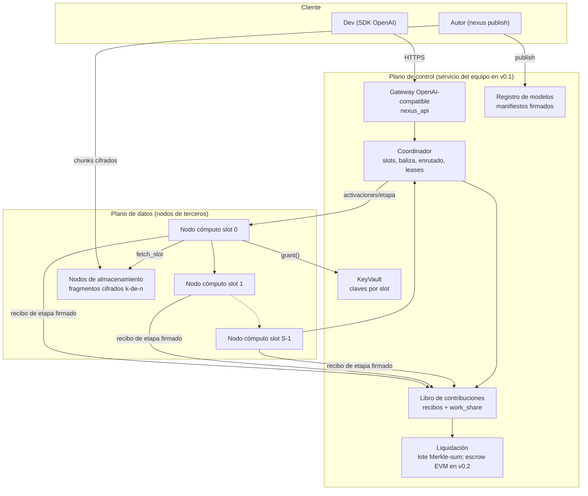
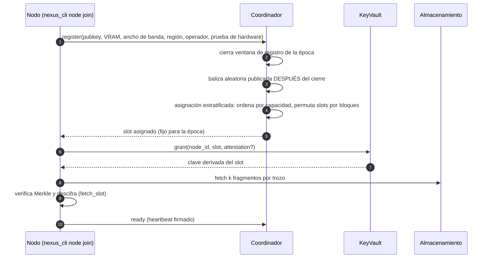
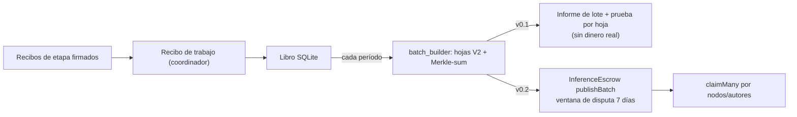

# 03 · Arquitectura

Versión 0.1 · 2026-10-27. Convención: **[EXISTE]** = hay código probado en el repo; **[SIM]** = solo en `research/swarm-sim`; **[NUEVO]** = a construir; **[PROPUESTA]** = formato/valor a validar con el prototipo.

## 1. Principios

1. Un operador, un slot: ningún operador reúne más de 1/S del modelo (`swarmsim.py::assign_slots`, `max_fraccion_por_operador`).
2. Pesos en reposo solo como ciphertext con erasure coding; la clave solo llega al nodo asignado.
3. El nodo de cómputo **sí** ve su slot en claro en memoria (inevitable sin TEE/MPC).
4. Pago por trabajo verificado; la medición la hace el gateway/coordinador, no el nodo.
5. **v0.1 está centralizado a propósito**: gateway, coordinador, libro y registro son un servicio del equipo. Lo descentralizado son el cómputo y el almacenamiento. Decirlo en toda comunicación.
6. Interfaces sustituibles (`Cipher`, `Signer`, `FragmentStore`, `Transport`) para cambiar cripto/almacenamiento sin tocar el protocolo.

## 2. Vista de componentes



| Componente | Responsabilidad | Estado | Código / origen | Confianza requerida |
|---|---|---|---|---|
| **Gateway** | `/v1/chat/completions`, `/v1/models`; auth, cuotas; mide tokens de entrada/salida; devuelve respuesta + recibo | Parcial [EXISTE para réplica completa] | `NEXUS/nexus/h0/router.py::_handle_chat_completion`, `nexus/api/` → `code/nexus_api/` | Ve el prompt y la respuesta en claro |
| **Coordinador** | Admisión de nodos, asignación operador→slot, enrutado por etapa ∝ velocidad, leases/reintentos, canarios | [NUEVO] (lógica de leases en `h0/router.py::recover_expired_jobs`, `requeue_dispatched_job`) | `code/nexus_runtime/coordinator.py` | Punto central de confianza y fallo en v0.1 |
| **Nodo de cómputo** | Descarga su slot, ejecuta capas `[a,b)`, mantiene KV de sesión, firma recibo de etapa | [NUEVO] | `code/nexus_runtime/node_agent.py`, `stage.py` | Tiene su slot en claro en memoria |
| **Nodo de almacenamiento** | Guarda fragmentos cifrados contenido-direccionados | [NUEVO] | `code/nexus_storage/store.py` (`FragmentStore`, `DirStore`) | Solo ve ciphertext; puede negar servicio |
| **Libro de contribuciones** | Persiste recibos de etapa y de trabajo, `work_share` por nodo y autor | [NUEVO] (esquema SQLite análogo a `h0/router.py` `receipts`) | `code/nexus_runtime/ledger.py` | Integridad = integridad de la BD y del firmante |
| **Liquidación** | Agrega libro en lotes Merkle-sum; v0.2 publica en escrow | [EXISTE] off-chain/on-chain local | `NEXUS/settlement-evm/{batch_builder.py,receipt_to_batch.py,src/InferenceEscrow.sol}` | Signer de gateway de confianza |
| **Registro de modelos** | Publica/consulta manifiestos firmados; versiones; revocación | [NUEVO] | `code/nexus_storage/manifest.py`, `publish.py` | Firma del autor; el registro no puede falsificarlos |
| **KeyVault** | Deriva y entrega clave por slot a un nodo asignado | [NUEVO] | `code/nexus_storage/vault.py` | Si se compromete, descifra todo el modelo almacenado |

## 3. Flujos

### 3.1 Publicar un modelo

```mermaid
sequenceDiagram
  autonumber
  participant A as Autor (nexus_cli)
  participant P as publish_model
  participant S as FragmentStore
  participant R as Registro
  A->>P: layers[], model_id, version, S, k, n, licencia, royalty_bps
  P->>P: agrupa capas en S slots (S>=3 en demo)
  P->>P: master_key aleatoria; clave por slot = KDF(master, slot)
  P->>P: cifra cada slot (Cipher: stream+HMAC; NOT AUDITED)
  P->>P: erasure coding k-de-n por trozo; Merkle por slot
  P->>S: put(fragmento) -> cid = sha256
  P->>P: ModelManifest + firma Ed25519 del autor
  P-->>A: (manifest, master_key)
  A->>R: manifest.to_json()
  R->>R: verify() firma + Merkle + licencia presente
```

Contrato de código: `publish_model(layers, *, model_id, version, n_slots, ec_k, ec_n, store, author_signer, license, royalty_bps=0, n_slices=1) -> (ModelManifest, master_key)` (brief §6). **La `master_key` es el activo más sensible**: v0.1 la entrega al autor para que la deposite en el `KeyVault` del coordinador; ver §7 de `04-modelo-de-amenazas.md` y ADR-06.

### 3.2 Unirse como nodo



Notas: **[SIM]** unir un nodo a un slot de 2,19 GB (S=16, k=10, n=16, 80 % fuentes online) ≈ 60 s p50 / 231 s p95. La asignación estratificada conserva eficiencia 0,956 (vs 1,00 determinista y 0,83 aleatoria) y el atacante no elige slot (`swarmsim.py` escenario 7a). El "cierre de registro + baliza" es lo que impide elegir slot; **la baliza inmanipulable no existe aún** [NUEVO]; v0.1 la genera el coordinador (centralizado, declarado).

### 3.3 Inferencia por etapas

```mermaid
sequenceDiagram
  autonumber
  participant D as Dev
  participant G as Gateway
  participant C as Coordinador
  participant N0 as Nodo slot 0
  participant N1 as Nodo slot 1
  participant N2 as Nodo slot 2
  participant L as Libro
  D->>G: POST /v1/chat/completions
  G->>G: auth, cuota, tokeniza, crea job_id
  G->>C: job(job_id, model_id, tokens)
  C->>N0: stage(job_id, seq, tokens) + JWT de despacho
  N0->>N0: embeddings + capas [0,a); KV de sesión
  N0-->>C: activaciones h0 + recibo de etapa firmado
  C->>N1: stage(job_id, seq, h0)
  N1-->>C: h1 + recibo de etapa
  C->>N2: stage(job_id, seq, h1)
  N2->>N2: capas finales + logits + muestreo
  N2-->>C: token + recibo de etapa
  loop por token hasta EOS/max_tokens
    C->>N0: siguiente token (reutiliza KV)
  end
  C->>L: recibos de etapa + recibo de trabajo (work_share)
  C-->>G: texto + usage
  G-->>D: respuesta OpenAI + recibo
```

Decisiones de enrutado:
- Cada etapa se asigna a un nodo del slot elegido **con probabilidad ∝ velocidad medida** (heartbeats + latencia real). **[SIM]** eficiencia 1,0 con asignación equilibrada.
- La sesión (caché KV) queda **pegada** al nodo elegido por etapa mientras dura el job; si cae, se reenruta y se recomputa el prefijo (coste de rendimiento, no de correctitud).
- Reintento ante fallo en otro nodo del slot: **[SIM]** sustituir un nodo es reenrutar (ms), no descargar.
- Latencia **[SIM]**: decode_p50 ≈ 159 ms/token con S=8 y 354 ms/token con S=16 (solo red entre etapas). Cada slot extra añade un salto. **[POR VERIFICAR]** con prototipo real; el simulador no modela colas ni KV.
- Privacidad: el primer slot ve embeddings (reversibles a tokens) y el último ve logits; el gateway ve el texto. **No hay confidencialidad del prompt frente a la red.**

### 3.4 Liquidación



- v0.1: el lote se construye y **se verifica localmente** (suma de hojas = total, pruebas válidas con `batch_builder.verify_claim`). No hay token ni pago.
- v0.2: publicación en escrow de testnet. El escrow actual asume signer de gateway de confianza y árbitro `owner` (centralizado) — `NEXUS/settlement-evm/src/InferenceEscrow.sol`. Cambios necesarios antes de usarlo con varios nodos externos: ver ADR-03/ADR-04 y `04-modelo-de-amenazas.md`.

## 4. Protocolos y formatos

### 4.1 Manifiesto de modelo

Contrato fijado por el brief §6 (`eng-storage`). Representación JSON **[PROPUESTA]** de campos y reglas:

```json
{
  "model_id": "tiny-lm",
  "version": "1.0.0",
  "n_layers": 12,
  "n_slots": 4,
  "n_slices": 1,
  "ec_k": 10, "ec_n": 16,
  "cipher": "stream-hmac-sha256 (NOT AUDITED)",
  "license": "<SPDX o nombre de la licencia del modelo base>",
  "author_pubkey": "<ed25519 hex>",
  "royalty_bps": 500,
  "slots": [
    {"slot": 0, "slice": 0, "chunk_cids": ["<sha256>", "..."], "merkle_root": "<hex>", "size": 123456}
  ],
  "signature": "<ed25519 hex sobre JSON canónico sin 'signature'>"
}
```

Reglas: JSON canónico (`sort_keys`, separadores compactos, como `nexus_common.canonical_json`); `model_id@version` inmutable; `slots[*].chunk_cids` ordenados por índice de fragmento; `verify()` comprueba firma y estructura (n_slots, ec_k ≤ ec_n, licencia no vacía). Un hash del manifiesto (`manifest_id = sha256(canonical)`) es el identificador que citan los recibos y que se ancla on-chain en v0.2 (el brief lo menciona; **no hay anclaje en código aún**).

### 4.2 Recibo de etapa (nodo → libro) **[PROPUESTA]**

Extiende el recibo H0 (`NEXUS/nexus/h0/nexus_common.py`, `worker_agent.py` l.215-234: `job_id, node_id, model, input_tokens, output_tokens, nram_used, output_sha256, price_micro_usd, shares, scaffolding_tokens, started_at, finished_at`).

```json
{
  "v": 2, "kind": "stage",
  "job_id": "job_000123", "manifest_id": "<sha256>",
  "slot": 1, "node_id": "node_ab12...", "epoch": 7,
  "tokens_processed": 512, "seq_first": 0, "seq_last": 511,
  "in_hash": "<sha256 de las activaciones de entrada>",
  "out_hash": "<sha256 de las activaciones de salida>",
  "compute_ms": 1840,
  "started_at": "...", "finished_at": "...",
  "signature": "<ed25519 sobre JSON canónico>"
}
```

Verificación: firma con la clave registrada del nodo; **encadenado** `out_hash(slot i) == in_hash(slot i+1)` (detecta manipulación en el tránsito, **no** que el cómputo sea correcto); `tokens_processed` contrastado con el conteo del gateway (tolerancia heredada de H0: ≤ 1 % de discrepancia).

### 4.3 Recibo de trabajo (coordinador → libro) **[PROPUESTA]**

```json
{
  "v": 2, "kind": "job",
  "job_id": "...", "client_id": "...", "model_id": "...", "manifest_id": "...",
  "input_tokens": 812, "output_tokens": 256,
  "stage_receipts": ["<sha256 de cada recibo de etapa>", "..."],
  "work_share": {"node_ab12": 0.0312, "node_cd34": 0.0310, "...": 0.0},
  "author_royalty": {"author_pubkey": "<hex>", "bps": 500},
  "price_micro_usd": 1234,
  "output_sha256": "<sha256>",
  "coordinator_signature": "<ed25519>"
}
```

**`work_share`**: para el nodo *j* del slot *s*: `w_j = (capas_s / n_layers) × (tokens_j / tokens_slot_s)`. Σ w_j = 1 sobre todos los nodos. Se pagan `75 %` de `price` a nodos según `w_j`, `royalty_bps` al autor, y el resto a verificación/tesoro **[PROPUESTA: reparto heredado de `nexus_common.split_payment` 75/10/5/5/5; revisar en ADR-03 porque sin token no hay "quema"]**.

### 4.4 Mensajes de red (v0.1: HTTPS JSON con firma)

| Mensaje | Origen → destino | Autenticación (patrón reutilizado) |
|---|---|---|
| `register`, `heartbeat`, `poll` | nodo → coordinador | firma de petición con nonce y ventana ±60 s (`nexus_common.sign_node_request`) |
| `stage` (despacho) | coordinador → nodo | JWT EdDSA ligado a nodo+job+etapa, TTL ≤ 30 min (`issue_job_jwt`) |
| `stage_result` | nodo → coordinador | firma de petición + recibo de etapa firmado |
| `grant` | nodo → vault | firma del nodo + asignación vigente |
| `put/get fragment` | nodo/autor ↔ almacenamiento | contenido-direccionado (verifica sha256); sin auth de lectura (son ciphertext) |

Transporte de activaciones: tensores serializados (fp16/bf16) en binario; **[POR VERIFICAR]** tamaño: para hidden=8192 y fp16 son 16 KB/token/salto en decode. La compresión de activaciones solo está modelada como factor de ancho de banda en el simulador.

## 5. Mapa de ficheros hacia `nexus-project/code/`

```
code/
├── nexus_storage/            (eng-storage)  Contrato brief §6
│   ├── manifest.py           ModelManifest (to_json/from_json/verify)
│   ├── store.py              FragmentStore, DirStore (sha256)
│   ├── erasure.py            encode/decode k-de-n  (GF(256), stdlib)
│   ├── crypto.py             Cipher/Signer (Ed25519 RFC 8032 puro-Python: NOT AUDITED)
│   ├── publish.py            publish_model, fetch_slot
│   └── vault.py              KeyVault.grant/revoke (clave derivada por slot)
├── nexus_runtime/            (eng-runtime)
│   ├── coordinator.py        admisión, asignación estratificada, enrutado ∝ velocidad, leases
│   ├── node_agent.py         agente de nodo: grant → fetch_slot → servir etapas
│   ├── stage.py              ejecución de rango de capas (modelo pequeño real)
│   ├── receipts.py           recibos de etapa/trabajo, canonical_json
│   └── ledger.py             SQLite + lotes (importa settlement-evm/batch_builder.py por ruta)
├── nexus_api/                gateway OpenAI-compatible, auth y cuotas
├── nexus_cli/                `nexus publish`, `nexus node join`, `nexus verify`, `nexus demo`
├── deploy/                   Compose/scripts (plantilla de NEXUS/deploy)
└── tests/{storage,runtime}/
```

Reutilización por origen: `receipts.py` ← `h0/nexus_common.py`; leases y aislamiento por cliente en `coordinator.py` ← `h0/router.py`; `ledger.py` ← `settlement-evm/batch_builder.py` y `receipt_to_batch.py`; `nexus_api` ← contrato de `nexus/api/`.

## 6. Decisiones de escala

| Parámetro | Valor v0.1 | Valor objetivo | Fuente |
|---|---|---|---|
| **S (slots)** | 3–4 en demo con modelo pequeño | 8 (batch) a 16 (más secreto) para 70B | **[SIM]** S=8: 2,5–7 tok/s, exposición 3 réplicas @30 % = 0,03; S=16: 1,6–4 tok/s, 0,0005. Cada slot extra +1 salto |
| Slot mínimo viable | cabe en VRAM del nodo más modesto | S=4 deja fuera 25 % de nodos (VRAM) | **[SIM]** escenario 5 |
| **Asignación** | Estratificada con baliza (centralizada) | Baliza verificable | **[SIM]** eficiencia 0,956; atacante: 54 identidades (p99 115) para 16 slots vs 16 si elige slot |
| **Enrutado** | ∝ velocidad medida dentro de un slot | + reputación | **[SIM]** eficiencia ~1,0 |
| **Erasure coding** | 10-de-16 (1,6×); en demo k,n pequeños | ídem | **[SIM]** pérdida 0,0005 vs 0,0103 para 3 réplicas (3×) con 5 % de pérdida por época |
| **Fallos correlados** | n/a | tope por operador (15 % del slot opcional) | **[SIM]** S=16: región cae → 0,74; operador mayor → 0,96 |
| **Corte por capa T** | T=1 | T=4–8 en modo batch con pods co-localizados | **[SIM]** T=8, coalición 10 %: P=0,005, pero 0,6 s/token a 0,5 ms RTT; 22 s a 20 ms |
| **Réplicas por región** | no | una copia por región si se necesita QoS | **[SIM]** latencia 351→196 ms; −25 % de throughput total |

**Aviso de coherencia (C10 en `01-analisis-repositorio.md`):** el diseño de slots con todos los nodos de cada slot (S=16, ~300 nodos por slot) reúne el modelo con P≈0,44 si una coalición controla el 2 % de los operadores y P≈0,99 al 5 % (T=1). Las cifras favorables de "S=8 → 0,03 @30 %" son de un diseño con 3 réplicas por etapa. **El diseño de slots escala throughput a costa de secreto.** Para v0.1 con modelo pequeño es irrelevante; para v1.0 exige T>1, TEE o coste de identidad.

## 7. Evolución a entrenamiento distribuido

| Fase | Qué se añade | Cuello de botella **[SIM]** | Qué lo desbloquea |
|---|---|---|---|
| 0 (v0.1–0.2) | Solo inferencia | — | — |
| 1 (v1.0) | **Fine-tuning de adaptadores** (LoRA) sobre pipeline ya existente: los gradientes del adaptador fluyen por las mismas etapas; los pesos base congelados no se actualizan | Comunicación por etapa; backward duplica saltos | E-Compresión (ver `05-roadmap.md`) |
| 2 (v1.x) | **Híbrido**: P pipelines replicados; cada etapa sincroniza solo con sus réplicas homólogas (all-reduce por etapa) | 70B/24 GB ⇒ ~59 etapas; sin compresión utilización 7 %, con ×10 ≈ 53 %; 1000 pipelines ≈ 6,9 M tok/s, **caso ideal sin churn** | Compresión ≥10× sin pérdida de convergencia **[NO medido: el simulador no evalúa convergencia]** |
| ✗ | DiLoCo | Requiere réplica completa: solo ≲1B en 24 GB; contradice "ningún operador tiene el modelo" | Descartado (ADR-05) |

El manifiesto ya prevé `n_slices` (T) y la separación `slot/slice` para reutilizar el formato en training. Los recibos de etapa admiten `kind: "train_step"` con `grad_hash`. Nada de esto está implementado ni probado: **no mencionar entrenamiento distribuido como capacidad** (lista de afirmaciones prohibidas, doc 04).

## 8. Riesgos de arquitectura (resumen; detalle en doc 05)

1. Corrección numérica entre hardware distinto en doble ejecución (no determinismo fp).
2. Overhead real de activaciones y KV frente al modelo del simulador.
3. Centralización de coordinador/vault/gateway en v0.1.
4. La baliza de asignación y la identidad (Sybil) no están resueltas.
