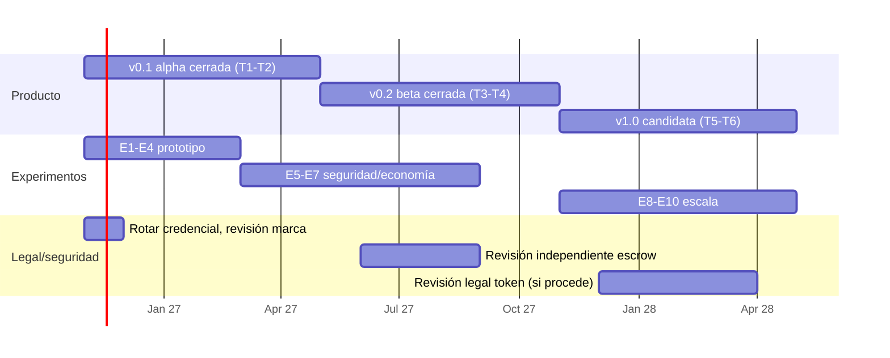

# 05 · Roadmap a 18 meses

Versión 0.1 · 2026-10-27. Seis trimestres desde noviembre de 2026 (T1 = nov 2026–ene 2027 … T6 = ago–oct 2028; el calendario es una **propuesta [SUPUESTO]**, sin compromisos de fecha externa). Cada hito tiene criterio de salida **medible**; los umbrales son supuestos iniciales a revisar con datos. Si un criterio de "kill" se cumple, se detiene la fase siguiente.

## 1. Hitos trimestrales

| T | Fechas | Hito | Entregables | Criterio de salida medible |
|---|---|---|---|---|
| **T1** | nov 26 – ene 27 | **Fundamentos**: almacenamiento + publicación + primera inferencia por etapas local | `nexus_storage` (manifiesto, EC, store, publish, vault); `nexus_runtime` mínimo; demo con modelo pequeño en 3–4 procesos; rotación de credencial; revisión de marca | (a) `fetch_slot` reconstruye capas exactas con n−k fragmentos perdidos; (b) salida por etapas ≡ monolítica en 100 prompts a T=0 (o desviación documentada); (c) demo en un comando; (d) tests `python3 -m unittest` verdes y reportados; (e) credencial rotada (confirmado por humano) |
| **T2** | feb – abr 27 | **v0.1 alpha cerrada**: ≥2 máquinas reales, gateway OpenAI, recibos por etapa, libro y lote | `nexus_api`, `nexus_cli`, coordinador con asignación estratificada, recibos v2, lote Merkle, despliegue plantilla | (a) SDK OpenAI con `base_url` funciona; (b) 100/100 jobs con recibos válidos, ≥2 máquinas físicas distintas; (c) reparto de trabajo ∝ velocidad ±10 %; (d) medida real de tok/s por stream y tiempo de unión de nodo vs **[SIM]**; (e) landing con estado honesto (lista doc 04 §7) |
| **T3** | may – jul 27 | **Verificación y beta privada** | Canarios + doble ejecución muestreada; reputación; streaming SSE; reparación de fragmentos; 5–10 operadores invitados (testnet); entrevistas a 20 devs | (a) ≥5 operadores independientes 7 días con ≥95 % de jobs sin reintento; (b) falsos positivos de verificación < 5 % **(kill si ≥5 %)**; (c) detección de nodo tramposo inyectado ≥ 95 % **[SUPUESTO]** en canarios; (d) ≥10 devs con ≥100 peticiones; (e) 20 entrevistas con tabla de resultados |
| **T4** | ago – oct 27 | **v0.2 beta cerrada + liquidación testnet** | Escrow en testnet pública (tras revisión independiente), disputas con bond o árbitro multisig, regalías a autores, observabilidad, runbooks | (a) revisión externa del escrow sin hallazgos críticos abiertos; (b) lote publicado y reclamado en testnet con balances conciliados con el libro 100 %; (c) disponibilidad del gateway ≥ 99 % en 30 días **[SUPUESTO]**; (d) coste real medido por 1 000 tokens (datos propios) |
| **T5** | nov 27 – ene 28 | **Escala y mitigaciones de coalición** | Modelo 7B+ con S=8; identidad con coste (comisión, prueba de hardware); baliza verificable; decisión T/TEE según experimentos | (a) throughput y latencia medidos con ≥50 nodos reales/simulados bajo carga; (b) simulador recalibrado con medidas; (c) política de identidad probada con adversario interno (red team), coste de reunir modelo ≥ umbral fijado por negocio; (d) decisión escrita sobre T/TEE |
| **T6** | feb – abr 28 | **v1.0 candidata**: red abierta con permiso suave | Registro con identidad/coste, catálogo con licencias, SLAs honestos, opción token **solo** si pasa revisión legal; auditoría | (a) 30 días con ≥20 operadores independientes y ≥95 % jobs completados; (b) auditoría externa de contratos y runtime sin críticos abiertos; (c) precios con fuente y coste real: margen bruto ≥ 0 por trabajo **[SUPUESTO]**; (d) dictamen legal sobre token/pagos documentado |

## 2. Equipo mínimo por fase

| Fase | Roles (FTE) | Notas |
|---|---|---|
| T1–T2 (v0.1) | 1 ing. sistemas/ML (runtime y etapas), 1 ing. backend/cripto (storage, recibos, gateway), 0,5 producto/fundador | Hoy trabajan agentes; con equipo humano se necesita al menos alguien que opere hardware real |
| T3–T4 (v0.2) | + 1 ing. contratos/seguridad (0,5–1), + 0,5 DevRel/comunidad de operadores, + asesor legal puntual | Revisión independiente externa del escrow (no interna) |
| T5–T6 (v1.0) | + 1 ing. ML (compresión/TEE/corte T), + 1 SRE/operaciones, + 0,5 legal/compliance, + 0,5 finanzas | Auditoría externa |

## 3. Dependencias

| Dependencia | Necesaria para | Riesgo si falta |
|---|---|---|
| Modelo pequeño real con licencia clara y capas uniformes | T1 | Demo no representativa |
| Librería cripto auditada (`cryptography`) en entorno de ejecución | T1–T2 | Cripto en Python puro (NOT AUDITED) en demo |
| ≥2 máquinas físicas / red real | T2 | Resultados solo loopback |
| Operadores externos invitados | T3 | Sin validación de oferta |
| Revisión independiente del escrow y presupuesto | T4 | No hay testnet pública |
| Revisión legal (valores/MiCA) | T6 | Token fuera de alcance |
| Comprobación de marca "NEXUS" (GTM) | Antes de lanzar landing pública | Conflicto de marca; sin resolver |
| Rotación de credencial `8445b54` | Ya | Incidente |

## 4. Riesgos técnicos y plan de validación

| ID | Incertidumbre | Qué podría pasar | Experimento que la resuelve | Criterio |
|---|---|---|---|---|
| R1 | **Latencia real por salto y por etapa** vs simulador (sin colas, KV, serialización) | Tok/s < **[SIM]** 1,6–7; producto inviable para batch pequeño | **E1 Prototipo 3–4 procesos** (T1) → **E2 2+ máquinas LAN/WAN** (T2); medir decode p50/p95, TTFT, bytes/token | Error vs simulador < 2× **[SUPUESTO]**; si peor, replantear S o compresión |
| R2 | **Equivalencia numérica** por etapas y entre hardware distinto | Doble ejecución con falsos positivos | **E3 Determinismo**: mismo prompt, T=0, 3 tipos de nodo; comparar activaciones y tokens | 100 % tokens iguales o tolerancia fijada y falsos positivos <5 % |
| R3 | **Overhead de erasure coding + cifrado en Python** (rendimiento, memoria) | Publicar/unirse tarda minutos | **E4 Benchmark storage**: GB/s de encode/decode con stdlib vs librería nativa | Unir un nodo a un slot en < 5 min a la velocidad de red real |
| R4 | **Pago ∝ velocidad incentiva engañar la medición** | Nodos inflan velocidad | **E5 Adversario interno**: nodo que declara velocidad falsa; medir detección | Desvío detectado > 95 % |
| R5 | **Verificación** (canarios/doble ejecución) coste vs cobertura | Pool de verificación > margen | **E6 Simulación económica con datos reales de T3** | Coste de verificación ≤ 5 % del ingreso **[SUPUESTO heredado: 5 % pool]** |
| R6 | **Coaliciones** (diseño slots, 2 %→0,44) | El secreto es marketing hueco | **E7 Cuantificar con operadores reales**: concentración real de operadores; recalcular `coalition_coverage`. Evaluar T=2–4 y TEE | Decisión T/TEE con coste/latencia medidos |
| R7 | **Sybil / baliza** | Atacante reúne el modelo barato | **E8 Red team**: simular atacante con presupuesto X; probar comisión no reembolsable y huella | Coste de ataque ≥ valor del modelo estimado `[POR VERIFICAR]` |
| R8 | **Demanda**: ¿hay devs que acepten esa latencia? | Producto sin usuarios | **E-Demanda** 20 entrevistas + landing con lista de espera + piloto batch (T3) | ≥10 devs con uso real; ≥3 casos batch concretos **[SUPUESTO]** |
| R9 | **Oferta**: ¿hay operadores con GPU suficiente y fiables? | Sin capacidad | **E-Oferta** invitar 10 operadores; medir uptime real vs 85 % supuesto del simulador | Uptime medio ≥ 80 % y ≥ 5 retenidos a 30 días |
| R10 | **Coste vs mercado** | Precio no competitivo | **E9 Medición de coste por 1 000 tokens** (electricidad, hardware, red) y recopilar precios públicos con URL y fecha | Margen ≥ 0 sin subvención `[POR VERIFICAR]` |
| R11 | **Compresión de activaciones** (solo para training) | Entrenamiento inviable | **E10 Fine-tune pequeño** con compresión ×10 midiendo pérdida/convergencia | Pérdida final dentro de 5 % **[SUPUESTO]** del baseline |
| R12 | **Escrow con signer de confianza** | Fraude o error en pagos | **E11 Revisión externa + disputa con bond**; pruebas con múltiples nodos | Sin críticos abiertos |
| R13 | **Licencias de modelos** | Incumplimiento | Revisión legal por modelo del catálogo | Licencia validada antes de publicar |
| R14 | **Marca NEXUS / token NEX** | Cambio de nombre tardío | Búsqueda de marcas (GTM) antes de lanzar | Informe de GTM sin conflicto o plan B |

## 5. Puertas de decisión (go / no-go)

| Puerta | Cuándo | Condición para continuar | Si no |
|---|---|---|---|
| G1 | Fin T1 | Equivalencia de salida (E3) y round-trip de storage OK | Rediseñar `stage`/formato antes de más trabajo |
| G2 | Fin T2 | Tok/s medido dentro de 2× del simulador y ≥2 máquinas | Replantear S (menos etapas) o producto solo batch |
| G3 | Fin T3 | Falsos positivos <5 %, ≥5 operadores, ≥10 devs | No abrir beta; pivotar a nicho privado/enterprise o parar |
| G4 | Fin T4 | Escrow sin críticos; coste real medido | Quedarse en testnet privada |
| G5 | T5–T6 | Decisión T/TEE y coste de Sybil | No prometer resistencia a coalición; posicionar como "mitigación parcial" |

## 6. Qué NO está en el roadmap de 18 meses

Libp2p y DHT (aparcados), token público, entrenamiento distribuido de modelos base, multimodal, tools, un segundo modelo antes de superar G3 (consistente con spec §13.5).
